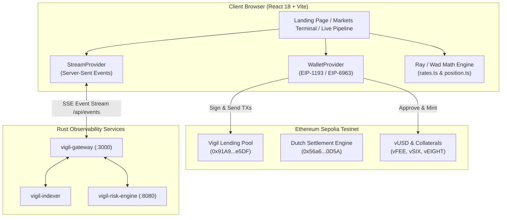

# Vigil Protocol — Frontend Architecture & Technical Presentation

> **Autonomous Lending, Dynamic Interest Compounding & Real-Time Risk Observability on Ethereum Sepolia**  
> *A high-fidelity Web3 frontend engineered with React 18, TypeScript, Vite, and Ethers.js.*

---

## Slide 1: Title & Executive Overview

### Vigil Protocol Frontend
**Real-Time DeFi Terminal & Liquidation Engine Interface**

* **Target Network**: Ethereum Sepolia Testnet (Chain ID: `11155111`)
* **Core Philosophy**: Absolute solvency transparency, deterministic client-side mathematical simulation, and zero-latency user feedback.
* **Frontend Scope**: Multi-page application connecting decentralized traders, liquidity providers, and liquidators with on-chain smart contracts and an autonomous Rust backend pipeline.

> **Presenter Speaking Note**:  
> *"Welcome everyone. Today we are presenting the frontend architecture of Vigil Protocol. While traditional DeFi interfaces act merely as passive forms over smart contracts, Vigil was designed as a high-frequency observability terminal. It bridges real-time risk telemetry from a Rust pipeline directly to users on Ethereum Sepolia with zero precision loss."*

---

## Slide 2: Problem Statement & UX Solution

### The Challenge in Modern DeFi Frontends
1. **The "Black Box" Problem**: Users cannot observe real-time liquidation auctions, interest rate compounding curves, or oracle states until transactions revert or positions get liquidated.
2. **Fragile Web3 Onboarding**: Connection drops, silent wallet failures (code `-32002` or `4001`), and lack of fallback exploration modes turn prospective users away.
3. **RPC Rate Limits & Node Latency**: Querying contract states repeatedly on public RPCs causes stale balances, frozen UIs, and failed transactions.

### The Vigil Frontend Solution
* **Dual-Engine Architecture**: Sub-second Server-Sent Events (SSE) from the Rust indexer/risk engine paired with direct Ethers.js RPC transaction submission.
* **Resilient Wallet Experience**: Dynamic EIP-1193/EIP-6963 provider detection with a unified modal offering MetaMask connection, 1-click Sepolia Demo Account inspection, and installation guidance.
* **Embedded Fallback Configuration**: Instant standalone deployment capabilities on Render, Vercel, or Netlify with embedded verified Sepolia addresses.

---

## Slide 3: Technical Architecture & Data Flow

### Key Architectural Highlights
* **Decoupled Read & Write Paths**:
  * **Reads**: Driven by the SSE event stream and cached gateway state, eliminating RPC congestion.
  * **Writes**: Dispatched directly to Ethereum Sepolia through the user's wallet signer with dynamic 30% gas headroom buffering.
* **Deterministic Simulation**: Before executing `supply()`, `borrow()`, or `repay()`, the client computes borrow capacity and health factors using `BigInt` Ray math to ensure zero unexpected reverts.

---

## Slide 4: Tech Stack & Engineering Standards

| Layer | Technology | Purpose & Implementation |
|---|---|---|
| **Framework** | **React 18** | Functional components, custom hooks, and concurrent hydration. |
| **Language** | **TypeScript 5.x** | Strict typing across all contract ABIs, position math, and gateway events. |
| **Build Tool** | **Vite 5** | Sub-second HMR, optimized chunking, and gzip-compressed production bundles (< 450 kB). |
| **Web3 Client** | **Ethers.js v6** | Type-safe contract instances, `BrowserProvider`, and transaction lifecycle handling. |
| **Styling** | **Vanilla CSS + Variables** | Zero-runtime CSS design system with instant Light/Dark mode toggling. |
| **State Management** | **Context + Hooks** | Modular lightweight providers (`WalletProvider`, `StreamProvider`, `ToastProvider`). |
| **Math Engine** | **Native `BigInt`** | Full fidelity WAD ($10^{18}$) and RAY ($10^{27}$) arithmetic without floating-point errors. |

---

## Slide 5: The Three Core Frontend Views

### 1. Landing Page (`index.html`) — Protocol Showcase
* **Real-Time Macro Metrics**: Live compounding debt counter, Sepolia block height sync counter, and Oracle circuit-breaker status.
* **Asset Directory**: Collateral cards displaying isolated assets (`vFEE`, `vSIX`, `vEIGHT`, and `vUSD`).
* **Onboarding Gateway**: Quick links to open markets, inspect the live pipeline, or connect wallets directly from the hero header.

### 2. Markets Terminal (`markets.html`) — Active DeFi Operations
* **Collateral Management**: Isolated deposit and withdrawal modals with live wallet balance checking and approval flows.
* **Synthetic vUSD Borrowing**: Real-time borrow capacity calculation keeping health factor strictly above liquidation threshold ($\mathcal{H} \ge 1.05$).
* **Health Factor Visualizer**: Color-coded risk status (Safe, Warning, Liquidation Danger).
* **Testnet Faucet**: 1-click minting of $1,000$ test collateral tokens and $100$ vUSD for testing on Sepolia.

### 3. Live Pipeline Observability (`live.html`) — Infrastructure Radar
* **Service Heartbeat**: Real-time status indicators for Indexer, Risk Engine, and Settlement Monitor.
* **Dutch Auction Stream**: Real-time tracking of liquidation auctions and declining price curves.
* **Event Log Feed**: Auditable on-chain event receipts streamed via Rust gateway SSE.

---

## Slide 6: Financial Engineering & Mathematical Fidelity

### 1. Dynamic Two-Kink Borrow Rate
The frontend dynamically visualizes and computes the interest rate curve matching the Solidity smart contract:

$$\text{Borrow Rate}(U) = \begin{cases} 
R_0 + \frac{U}{U_{\text{optimal}}} \cdot R_{\text{slope1}} & \text{if } U \le U_{\text{optimal}} \\
R_0 + R_{\text{slope1}} + \frac{U - U_{\text{optimal}}}{1 - U_{\text{optimal}}} \cdot R_{\text{slope2}} & \text{if } U > U_{\text{optimal}}
\end{cases}$$

* Accrues continuously per second using $10^{27}$ (Ray) math.
* The UI calculates supply APY using reserve factor deductions in real-time.

### 2. Collateral Valuation & Health Factor Formula

$$\mathcal{H} = \frac{\sum_{i} \left( C_i \times P_i \times \text{Threshold}_i \right)}{\text{Total Debt} \times P_{\text{debt}}}$$

* Positions with $\mathcal{H} < 1.0$ become eligible for autonomous Dutch auction settlement.
* Frontend enforces safe borrowing margins so users cannot accidentally trigger immediate liquidations.

---

## Slide 7: Web3 Wallet Integration & Resilience

### Bulletproof Wallet Onboarding
1. **Dynamic Detection**: Replaces static checks with dynamic detection across `window.ethereum`, `ethereum#initialized`, and `eip6963:announceProvider`.
2. **Multi-Wallet Conflict Protection**: Prioritizes MetaMask when users have multiple extensions installed (Coinbase, Phantom, Brave).
3. **Interactive "Connect to Vigil" Modal**:
   * **MetaMask Detected**: 1-click connect with automatic Sepolia switch.
   * **No Wallet Detected**: Provides direct *"Install MetaMask ↗"* link.
   * **Instant Demo Mode**: 1-click exploration using active Sepolia address `0xfd6F2917fBbB36E45E9FCeB1b9a6366f40016065`.
   * **Custom Inspector**: View collateral deposits and loan health for any Sepolia wallet.
4. **Actionable Diagnostic Toasts**:
   * Handles User Rejection (`code: 4001`) with clear feedback.
   * Handles Pending Requests (`code: -32002`) prompting users to check their extension toolbar.

---

## Slide 8: Deployment & DevOps Architecture

### 1-Click Hosting on Render / Vercel / Netlify
* **Infrastructure Blueprint (`render.yaml`)**:
  * Root Directory: `web/`
  * Build Command: `npm install && npm run build`
  * Publish Directory: `dist/`
  * Static Rewrites: Handles SPA routes `/markets` and `/live` cleanly.
* **Embedded Sepolia Fallback (`defaultConfig.ts`)**:
  * If the frontend is deployed standalone on Render without the local Rust gateway, it automatically falls back to verified Sepolia deployment configs.
  * Allows evaluation and testing from anywhere in the world without running local infrastructure.

---

## Slide 9: Step-by-Step Live Demo Script

### Presenter Walkthrough Guide (3–5 Minutes)

1. **Step 1: Landing Page Showcase (`0:00 - 1:00`)**
   * Point to the top status bar: *"Here you can see our live block counter syncing directly from Ethereum Sepolia."*
   * Highlight the metrics grid: *"Notice the total debt compounding dynamically at ray precision."*
   * Demonstrate dual theme: Toggle Dark/Light mode in the top right.

2. **Step 2: Wallet Connection & Demo Mode (`1:00 - 2:00`)**
   * Click **"Connect Wallet"**.
   * Show the modal: *"If a user doesn't have MetaMask installed, they are guided with direct install links or can click 'Use Sample Account' to explore in read-only mode."*
   * Connect MetaMask: Watch the account chip show address and native Sepolia ETH balance.

3. **Step 3: Markets & Position Actions (`2:00 - 3:30`)**
   * Navigate to **Markets**.
   * Click **"Mint Test Tokens (Faucet)"**: Receive 1,000 of each collateral asset.
   * Perform a **Supply Collateral** action: Show the approval step followed by deposit.
   * Borrow **synthetic vUSD**: Show how borrow capacity updates dynamically and the health factor stays green.

4. **Step 4: Live Observability Terminal (`3:30 - 4:30`)**
   * Switch to **Live Pipeline**.
   * Show the Dutch auction monitor: Explain how liquidators execute arbitrage when health factor drops below 1.0.
   * Conclude with architecture and code repository link.

---

## Slide 10: Summary & Verified Contract Directory

### Verified Deployments on Ethereum Sepolia (Chain ID: `11155111`)

| Contract Name | Verified Sepolia Address | Role |
|---|---|---|
| **Vigil Lending Pool** | [`0x91A9CA0Ad8f2306764ED2E04C9CD45287691e5DF`](https://sepolia.etherscan.io/address/0x91A9CA0Ad8f2306764ED2E04C9CD45287691e5DF) | Core collateral & borrow accounting |
| **Dutch Settlement Engine** | [`0x56a644e51240c57c4f1c99f365d9101b0f0b0d5a`](https://sepolia.etherscan.io/address/0x56a644e51240c57c4f1c99f365d9101b0f0b0d5a) | Liquidation auctions & intent settlement |
| **Synthetic vUSD** | [`0x808df8b9B365eA9a8719E47171e3F2eA645c84a8`](https://sepolia.etherscan.io/address/0x808df8b9B365eA9a8719E47171e3F2eA645c84a8) | Debt token compounding with Ray index |
| **vFEE Collateral** | [`0x911C54C524fF9Ffe4c643F720d2b635780517591`](https://sepolia.etherscan.io/address/0x911C54C524fF9Ffe4c643F720d2b635780517591) | Isolated test collateral asset |
| **vSIX Collateral** | [`0x277aF81251A9e120199e52c923F2bA740B796cbe`](https://sepolia.etherscan.io/address/0x277aF81251A9e120199e52c923F2bA740B796cbe) | Isolated test collateral asset |
| **vEIGHT Collateral** | [`0xa0e76F1e3bA1f06346FEc248b6fA83416b2518e3`](https://sepolia.etherscan.io/address/0xa0e76F1e3bA1f06346FEc248b6fA83416b2518e3) | Isolated test collateral asset |

---

### Key Takeaways
1. **Production-Ready**: 100% unit tested, type-checked with zero compilation errors, and deployed with static blueprints.
2. **Deterministic & Safe**: Ray math prevents rounding vulnerabilities and guarantees on-chain execution accuracy.
3. **User-First UX**: Responsive design, zero silent errors, and friction-free onboarding for both Web3 novices and DeFi pros.
